# Clock & Gym Log

Two small Android apps I built for myself: a **clock** with alarms that don't miss and a billable-hours work timer, and a **gym log** that tells me what to lift next and rings when rest is over. Both run fully offline and share one look: warm monochrome with a choice of four accent colors.

This repository only holds the installable APKs and screenshots. It contains no source code.

**[Download the latest release →](../../releases/latest)**

These apps were built for my own commodity. I noticed that practically all custom apps for the appstore are ridden in ads, telemetry or simply have awful user interface. Fortunately for me I can tailor one for my needs (and hopefully) for yours too. 

---

## Clock

A replacement for the stock Samsung Clock, built around two things: alarms you can rely on, and logging billable hours.

<p>
  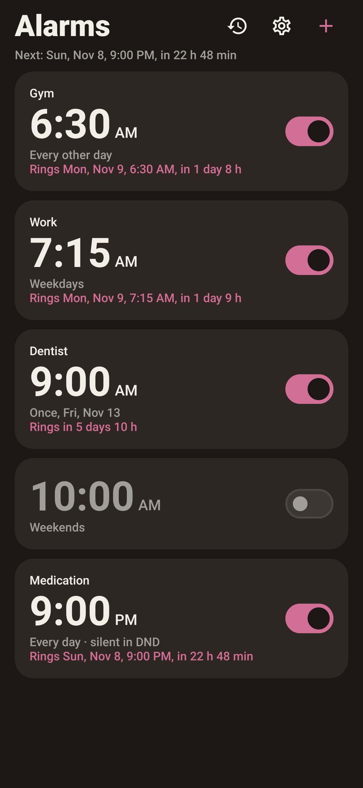
  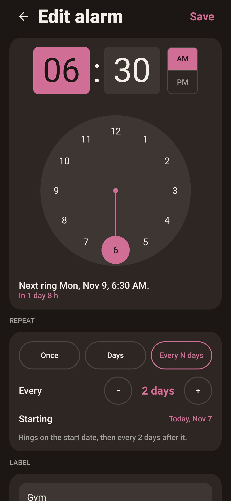
  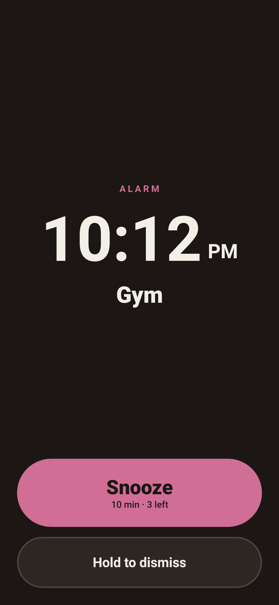
  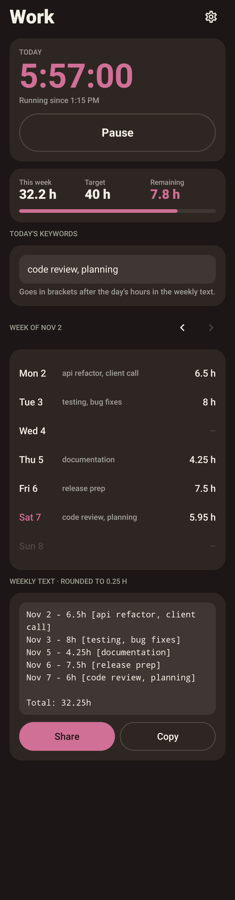
</p>

**Alarms**
- One-time alarms ("Will ring Fri, Nov 13, 6:30 AM, then delete"), chosen weekdays, or **every N days** from a start date.
- Next ring recomputed from the wall clock every time, so daylight saving and time zone changes never shift it.
- Rings over the lock screen with gentle rising volume. Big **Snooze**; **Dismiss** needs a one-second hold, so it can't happen by accident.
- Still rings after the phone restarts overnight, even before you unlock it.
- If nobody answers, it snoozes by itself as a backup ring, then tells you "You missed your 6:30 alarm". Missed alarms are kept in a history.
- Per-alarm **Ring in Do Not Disturb** switch.

**Work timer**
- Clock in / out with one tap, from the app, a widget, a Quick Settings tile or a launcher shortcut. Shows as **"Clocked in"** in the Now Bar.
- Today, this week, and hours left to your weekly target.
- One keywords line per day, manual edits for forgotten punches, a reminder if the timer runs too long.
- Weekly text ready to paste into an invoice, shared through the Android share sheet:
  ```
  Nov 2 - 6.5h [api refactor, client call]
  Nov 3 - 8h [testing, bug fixes]

  Total: 14.5h
  ```

**Also:** countdown timer and stopwatch (both in the Now Bar), home screen widget, daily automatic backup, JSON export/import.

<p>
  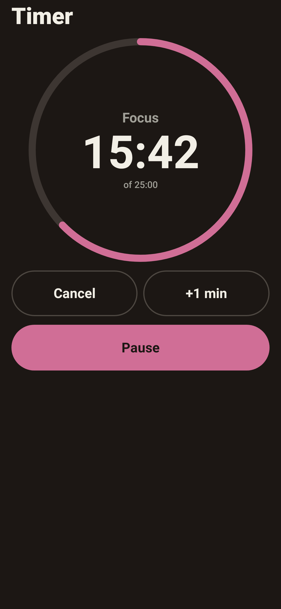
  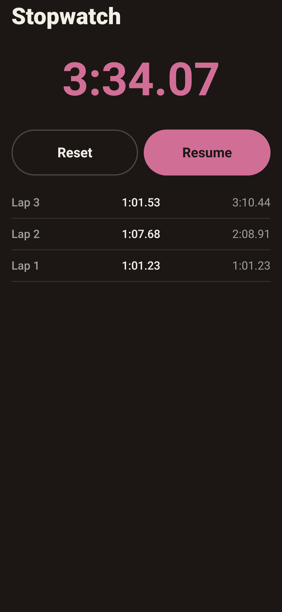
  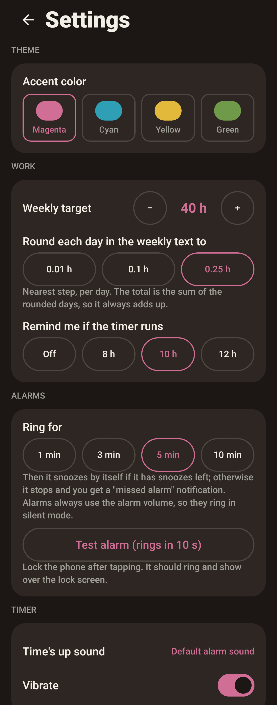
  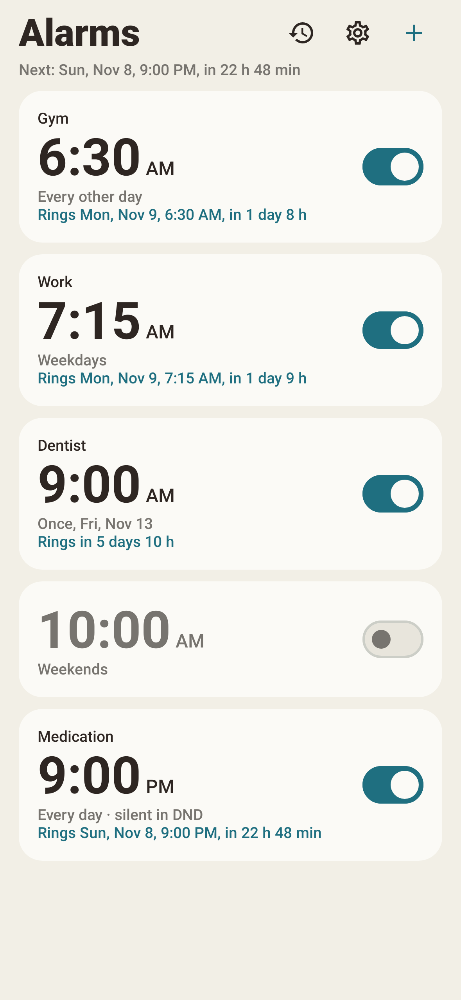
</p>

---

## Gym Log

A workout tracker for my own training plan: logs sets fast, prescribes the next weight, and runs a rest timer that works with the screen off.

<p>
  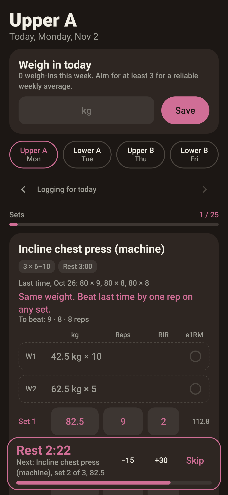
  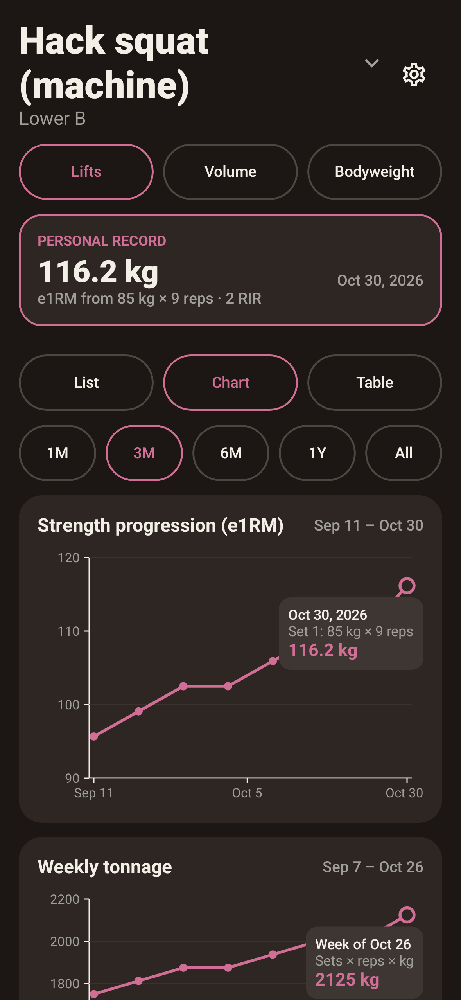
  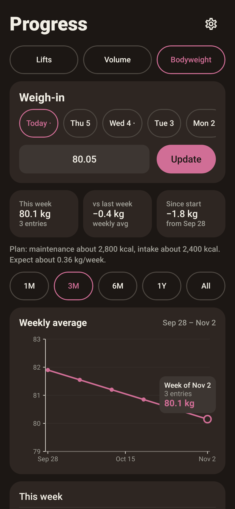
  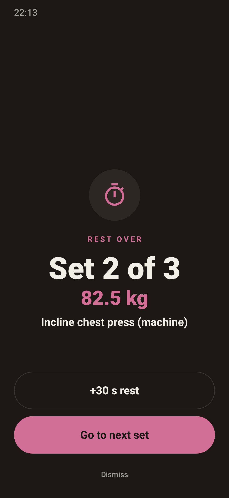
</p>

- Every exercise shows what to lift today and why, in one line.
- Rest timer starts by itself after each set, counts down in the Now Bar, and rings over the lock screen when rest is over.
- Estimated 1-rep max, warm-up sets, stall and fatigue detection, deload weeks, weekly volume per muscle.
- Progress charts, personal records, bodyweight trend.
- Home screen widget, daily automatic backup.

> The training plan is built into the app: it's **my** routine. Installing it gives you my program.

<p>
  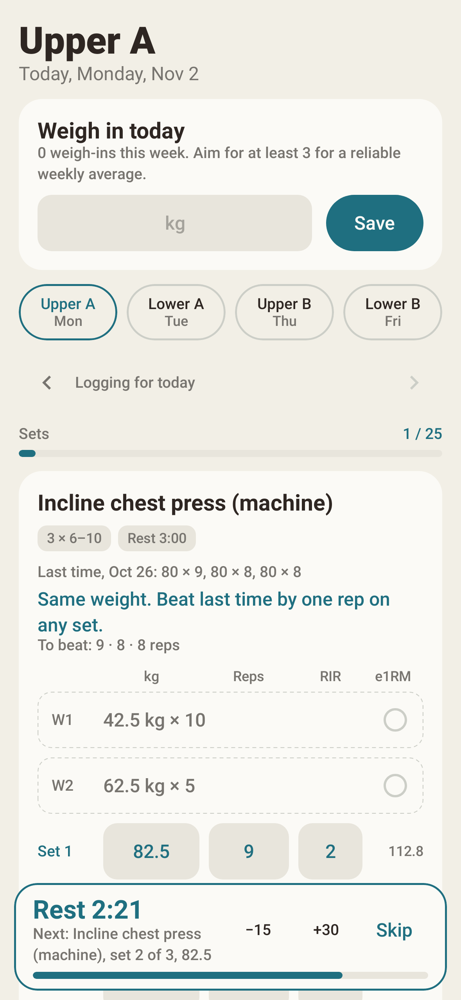
  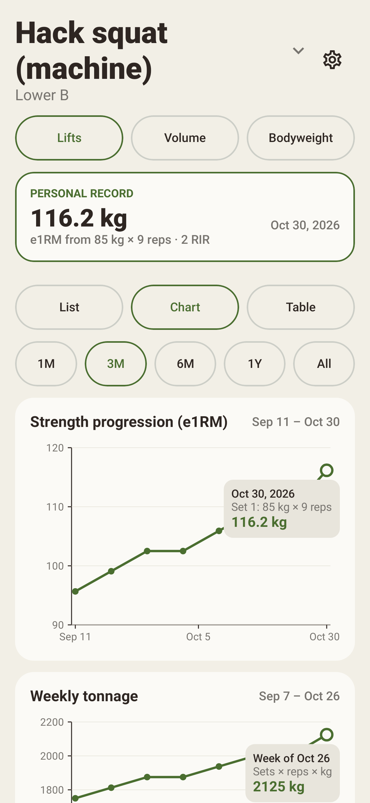
  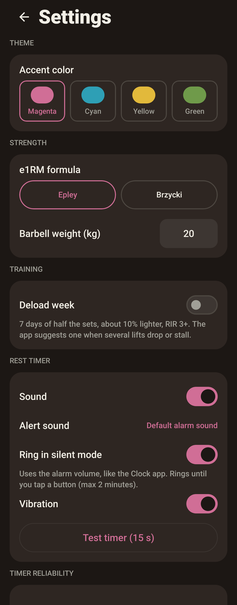
</p>

---

## Install

1. Open **[Releases](../../releases)** on your phone and download the APK you want (`clock-x.y.z.apk` or `gymlog-x.y.z.apk`).
2. Tap the file. Allow **Install unknown apps** for your browser or file manager when asked.
3. If Play Protect warns about an unknown developer, choose **Install anyway**.
4. Open the app, allow notifications, and go through **Settings › Alarm reliability** (Clock) or **Settings › Timer reliability** (Gym Log). On Samsung, set battery to **Unrestricted** so alarms and timers aren't delayed.

Updates install over the previous version and keep your data. Every release is signed with the same key.

**Requires** Android 8.0 or newer. Built and tested on a Samsung Galaxy A55 (One UI). Now Bar entries need a phone with Live Updates (Android 16, One UI 8 on Samsung); elsewhere they show as normal notifications.

## Privacy

- **No internet permission.** Neither app can connect to anything.
- No accounts, ads, analytics or tracking. All data stays on the phone.
- Backups are files you choose to save.

## Versions

| App | Latest | Notes |
|---|---|---|
| Clock | 1.1.1 |    Stopwatch and "Clocked in" in the Now Bar; alarm page fix
| Gym Log | 1.0.0 |  New palette and accent colors; Rest over rings like an alarm

## Terms

Personal project, provided as is, without warranty. You're welcome to install and use the apps. You can redistribute these APK files, just be mindful to direct them to the original repository for updates!

If you'd like to suggest features or provide feedback on the performance of this apps, feel free to reach me via TripPointHardware@proton.me
